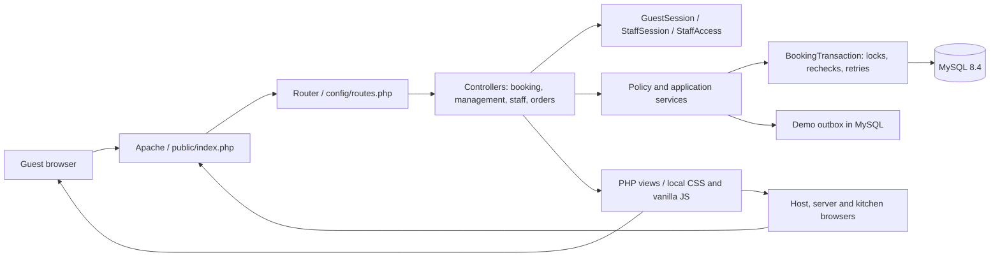
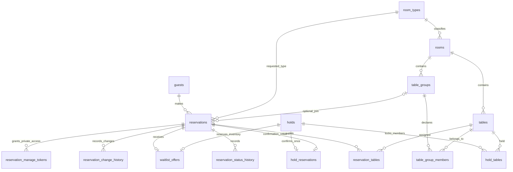
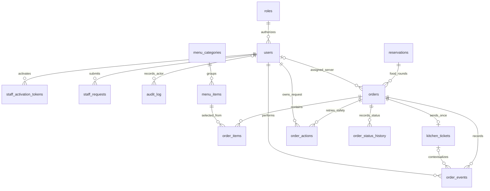

# Application architecture and database map

This describes the delivered PHP/MySQL application. The separate `prototype/` is a browser simulation. `PLAN.md` owns phase status; the API guides describe individual rules and routes.

## Request flow

Apache serves static assets directly. PHP routes return a page or JSON. PDO is PHP's database connection interface; prepared statements keep data separate from SQL. A transaction saves related changes together or rolls them all back. Physical-table and service-date locks protect inventory and pacing; mutable permissions, expiry and versions are checked again after locks are obtained.

The frontend shows server results; hiding a button is not authorization. Guest management requires a private capability link; its hash is stored. Staff use separate sessions, current role permissions and CSRF protection. A request UUID lets an interrupted action safely return the same saved result. Database time in Asia/Manila governs expiry and kitchen age.

## Core booking relationships

`reservation_tables` keeps released assignments and booking history; cancellation does not delete the reservation. Joined bookings occupy every declared member. `hold_reservations` binds the hold to its confirmation result. Waitlist offers are backed by real holds, and staff accept them.

## Staff and food service relationships

These diagrams show the principal relationships, rather than every column or foreign key. The executable schema is `database/init/01_schema.sql` through `07_menu_kitchen.sql`. Supporting tables are `settings`, `opening_hours`, `turn_times`, `pacing_rules`, `blackout_dates`, `booking_days`, `staff_login_limits`, `staff_security_lock` and `outbox`. Blackout scopes are interpreted by the service; they are not separate foreign keys to each target type.

Order lines snapshot name, price, station and tags. A sent ticket snapshots instructions and keeps its original fired time through hold/resume or recall. Kitchen readiness, server delivery, food-round closure and host completion are distinct actions. `closed` records finished service; no payment is collected. The historical schema's `paid` value is not used by the live workflow.

## Deployment boundary

| Stack | Guest/staff port | Database | Storage | Purpose |
|---|---|---|---|---|
| Main | 8080 | `.env` database, currently `tablebook` | `tablebook_dbdata` | Marvin's retained data and account |
| Isolated tests | 18080 | `tablebook_p3_test` | `tablebookp3check_p3_test_dbdata` | Guarded, destructive test fixtures |
| Disposable demo | 8082 | `tablebook_demo` | `tablebookdemo_demo_dbdata` | Rehearsal with separate staff activation |

All web ports bind to localhost. Demo MySQL has no host port or Adminer. `.env` and `.env.demo` are private, ignored by Git and excluded from the Docker image. No external fonts, scripts, images or API services are required by the live UI: fonts use the system, artwork uses CSS and inline SVG, and all assets/API requests are local.

PHP sessions are stored inside the app container. Recreating it can require signing in again; booking, order and ticket records remain in MySQL. Cookies are shared across ports on the same hostname, so use a separate browser profile for the demo and main app.

There is no public hosting, HTTPS termination, real messaging or payment integration in this delivery. Those require their own deployment review. Menu/room editors and advanced reporting remain extensions.
