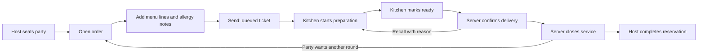

# Food Orders and Kitchen Tickets

Phase 6 connects the party's existing seated order to menu lines and persistent kitchen tickets. [README](../README.md#try-food-ordering-and-the-kitchen) has the walkthrough; [PLAN.md](../PLAN.md) remains the delivery roadmap.

## Permissions

| Operation | Admin / manager | Server | Kitchen | Host |
|---|---|---|---|---|
| Read menu and food orders | Yes | Own assigned and unassigned orders | No | No |
| Claim/edit/send/deliver/close/start next round | Yes | Claim first; then own orders | No | No |
| Read tickets and dietary instructions | Yes | Through own order detail | Yes, without prices or guest contacts | No |
| Start/ready/item-ready/hold/resume/recall | Yes | No | Yes | No |
| Void an order with a reason | Yes | No | No | No |
| Seat or complete reservations | Yes | No | No | Yes |

The API checks the current account and permission on every request. Transactional services repeat that check after inventory locks, including account revision and absolute session expiry. Server assignment is a database relationship, not a client-supplied identity. A server can claim an unassigned open order once; concurrent claims have one winner. Admin/manager can operate across assignments. This follows [OWASP authorization guidance](https://cheatsheetseries.owasp.org/cheatsheets/Authorization_Cheat_Sheet.html).

## Order lifecycle



Seating creates the first open order atomically in P5. Open orders may contain up to 50 active lines, quantity 1–30 per line, course 1–3, and 255-byte preparation notes. Quantity zero on an edit voids that line while retaining its history. Allergy instructions are bounded to 1,000 bytes. Input strings reject null bytes.

Adding a dish reads its current availability/category, price, name, station, and tags from MySQL. Price is saved as integer cents; a client price cannot override it. Later menu edits do not rewrite that line's snapshots. Totals are calculated on the server, preserving an existing stored service amount and rejecting overflow. No service fee or payment integration is added here.

Sending requires at least one active line and rechecks each dish's availability. It creates exactly one `kitchen_tickets` row per order, snapshots allergy instructions and booking notes, and records its server `fired_at`. Sent lines cannot be edited. Manager/admin may void the full order with a reason, preserving order/item/event records. Partial post-send cancellations and paid transactions are outside P6.

Kitchen state is `queued → preparing → ready → served`, with a `held` side state. A hold remembers the previous state; resuming returns to it without changing the original timer. Item-ready actions are restricted to that ticket while it is preparing. Items never automatically advance the ticket; **Mark entire ticket ready** explicitly marks its active lines ready. The server confirms food delivery. Recall requires a served, unclosed order and a reason, returns the ticket/items to preparation, and retains its original age.

**Close service** requires served food and records order status `closed`, separately from the ticket's `served` state. It neither collects money nor writes `paid`. A seated party may open another round only after the prior round closes or is voided, and only while no unfinished order exists. Server assignment and allergy instructions carry forward. Host completion refuses unfinished food and preserves the configured reset buffer; an empty open order is voided.

## API routes

| Method | Route | Purpose |
|---|---|---|
| GET | `/server` | Authorized food ordering page |
| GET | `/kitchen` | Authorized kitchen page |
| GET | `/api/service/menu` | Active-category menu, current prices, availability, stations/tags |
| GET | `/api/service/orders?date=YYYY-MM-DD` | Outstanding service plus that date's archived orders; assignment filtered |
| GET | `/api/service/order?id=123` | Authorized order, lines, ticket, table members, event history |
| GET | `/api/kitchen/tickets?date=YYYY-MM-DD&station=all` | Outstanding tickets, latest 20 served tickets for the service date, all-day quantities |
| POST | `/api/service/orders/action` | Versioned, idempotent order/ticket mutation |

All POSTs use the P5 staff cookie, JSON, and current `X-CSRF-Token` from `/api/auth/me`. Login/activation rotate that token: fetch `/api/auth/me` again before a mutation. A guest cookie cannot access these routes. Anonymous HTML redirects to sign-in; protected data returns 401. Responses use `ok` and structured `error: {code, message}`.

Example add request, using a real order version and menu ID from the authorized API:

```json
{
  "id": 123,
  "version": 2,
  "action": "add",
  "request_key": "cddabf82-5705-48ad-bbf6-7a3d76bf3428",
  "data": {"menu_item_id": 1, "qty": 2, "course_no": 2, "notes": "No onion"}
}
```

| Action | `data` fields |
|---|---|
| `claim`, `fire`, `start`, `ready`, `serve`, `close`, `round` | None |
| `add` | Integer `menu_item_id`, `qty`, `course_no`; optional `notes` |
| `edit` | Integer `item_id`, `qty` (0 removes), `course_no`; optional `notes` |
| `allergies` | `allergy_notes` |
| `item_ready`, `item_prepare` | Integer `item_id` belonging to that ticket |
| `hold`, `resume`, `recall`, `void` | Nonempty `reason` |

Successful mutations return `order` and `replayed`. Kitchen mutation responses omit prices, guest contacts, and host data. Typical errors: 401 missing/revoked/expired session; 403 permission, ownership, or CSRF denial; 409 stale order/state/request conflict; 422 invalid input/reason/station; 415 non-JSON mutation.

## Transactions and recovery

Mutations lock the service date, every physical table in ascending ID order, the reservation, order, current actor, and affected ticket/lines. This matches host completion and prevents completion racing past newly added food. All writes, totals, events, status history, audit identity, and request records commit or roll back together. The 25-table lock strategy favors correctness for this demo venue over mutation throughput.

Every action carries an account-bound request UUID and canonical payload hash. Repeating the same request returns the saved result without repeating its effect; a different payload using that UUID conflicts. A new request from a stale tab receives `order_changed`. The browser retains an interrupted request in memory and offers **Retry same request**. Reloading discards that pending request; reopen the order and review its actual persisted lines/status before continuing.

`07_menu_kitchen.sql` adds columns/tables and appends `closed` without reordering existing enum values. Its schema guards support reruns on an existing volume. Keep `.env` and the main volume. Recover an interrupted schema update by fixing the reported cause and rerunning `bin/setup-db.sh`; do not reset data or revert enum definitions after real orders use the new state. Date-relative demo seeding may add new sample rows on a new calendar day; it preserves existing booking history.

## Kitchen display behavior

Tickets are ordered oldest first. Timers use server `fired_at` and a server clock sample plus monotonic elapsed browser time. Age labels/borders are ON TIME (under 5 minutes), WORKING (5–10), LATE (10–15), and CRITICAL (15+); color is paired with text. Holds and recalls do not reset age. Dietary instructions and booking notes use literal text, including stored markup; menu tags do not guarantee an allergen-free dish.

Station filtering selects tickets with a matching active line, then displays their full contents. Whole-ticket controls affect all stations, so no hidden line is advanced accidentally. All-day counts show outstanding quantities for the displayed tickets. Current service/tickets remain visible across midnight; selected date applies to archived rounds/served history. Active work takes priority over archive rows in the bounded lists (100 orders/200 tickets), and recall shows the latest 20 served tickets; closed rounds cannot be recalled.

Kitchen polls every two seconds, server orders every six, while visible and idle. Editing dialogs, active inputs, and focused ticket/order controls pause refresh to preserve input/focus. Timers continue between successful polls. Connection failures show the last received state with a warning; session denial clears protected contents and redirects to sign-in. Browser back-cache restores reload the page. No SSE, WebSocket, external messages, or background auto-bump is implemented.

## Isolated verification

Fixture-resetting suites require `BOOKING_TEST_MODE=isolated` and database exactly `tablebook_p3_test`; HTTP/browser runners target port 18080. Never use these fixture scripts on the main database. Run sequentially because suites intentionally reset test data.

```bash
docker compose -f docker-compose.test.yml up -d --build
docker compose -f docker-compose.test.yml exec -T app php bin/setup-test-db.php
docker compose -f docker-compose.test.yml exec -T app php bin/test-booking.php
docker compose -f docker-compose.test.yml exec -T app php bin/test-management.php
docker compose -f docker-compose.test.yml exec -T app php bin/test-staff.php
docker compose -f docker-compose.test.yml exec -T app php bin/test-orders.php
BOOKING_TEST_MODE=isolated node tests/http-staff.mjs
BOOKING_TEST_MODE=isolated node tests/http-booking.mjs
BOOKING_TEST_MODE=isolated node tests/http-management.mjs
BOOKING_TEST_MODE=isolated node tests/http-orders.mjs
BOOKING_TEST_MODE=isolated PLAYWRIGHT_MODULE=/tmp/lumina-browser/node_modules/playwright/index.mjs node tests/browser-staff.mjs
BOOKING_TEST_MODE=isolated PLAYWRIGHT_MODULE=/tmp/lumina-browser/node_modules/playwright/index.mjs node tests/browser-booking.mjs
BOOKING_TEST_MODE=isolated PLAYWRIGHT_MODULE=/tmp/lumina-browser/node_modules/playwright/index.mjs node tests/browser-orders.mjs
docker compose -f docker-compose.test.yml exec -T app php bin/lint.php
bash bin/smoke.sh http://localhost:18080
git diff --check
```

See [browser setup](booking-api.md#browser-verification). Missing Chromium libraries must be available before a browser run can count as passed. `BROWSER_DOCKER_VIA_WSL=1` is available if the current shell needs a fresh WSL process. HTTP session fixtures run as `www-data`. Artifacts are temporary files outside the repo; activation secrets and main guest contacts are never printed.

P6 checks cover price/metadata snapshots, unavailable menu items, input limits, server ownership, cross-role denial, one-ticket fire/retry races, stale versions, hold/resume/item-ready/recall, unpaid service closure, host completion protection, subsequent rounds, account revision and expiry after locks, old archives not hiding active work, and midnight visibility. Browser cases cover real separate workspaces, persistence, interrupted responses, inert stored markup, server-age thresholds, station filters, delivery/recall, mobile/320px layout, and logout.
