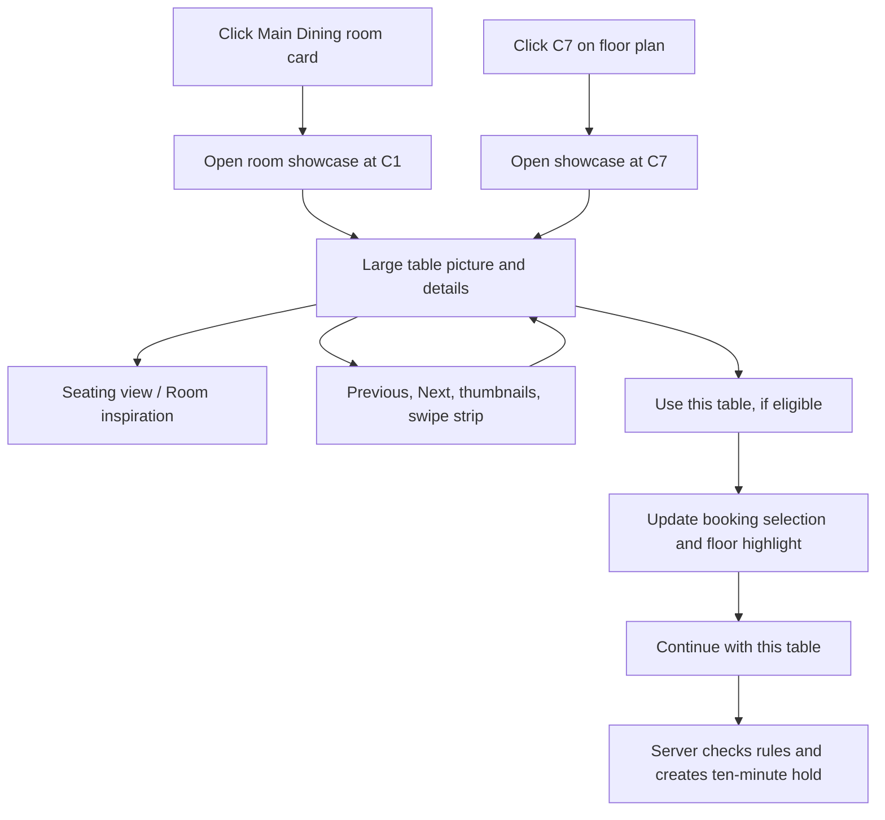

# Table showcase: research and implementation proposal

Research date: 2026-10-06. Owner: Marvin. This extends the completed P0–P7 laptop delivery. It records the original interactive design study and the delivered database-connected feature; see section 10 for live behavior and verification.

## 1. Request and inspected screen

Marvin wants a picture for every table, with sliding navigation, and clarified that **clicking a table opens its showcase**. The supplied screenshot shows the four cards under “Find your corner”: VIP Rooms, Main Dining, Group Tables and Terrace & Bar. These are room categories, rather than individual table records.

Recommended entry points:

1. Click a room card in that section → open the room's table showcase.
2. Click a physical table in the booking floor plan → open the same showcase already positioned at that table.
3. In the showcase, browse other tables using labelled thumbnails, Previous/Next buttons or touch scrolling.
4. Explicitly choose a table only when it is eligible for the current date/time/party. Looking at an image never starts a hold.

The interactive concept is [table-showcase/concept.html](table-showcase/concept.html). It opens directly as a local HTML file and uses local images rendered from original 3D furniture, with original SVG layouts as an image-error fallback. It represents all 25 current physical tables with their actual catalog codes, shapes and capacity ranges. It deliberately makes no reservation or availability claim.

During this session it is also available at **http://localhost:8092/table-showcase/concept.html**. To restart the local research preview from the repository folder:

```bash
python3 -m http.server 8092 --bind 127.0.0.1 --directory research
```

## 2. Recommended design

**A table-detail dialog with a large visual, two named image views and a room-filtered table strip.** On a laptop, visual and details sit side by side. On mobile, they stack in one scrollable dialog. Closing returns focus to the card or table that opened it.

The desired experience:



A dialog fits Marvin's click-to-open request and leaves the current booking screen in place. This is a project-specific design judgment, not a measured conversion result. It requires careful keyboard focus and a visible Close button. W3C's dialog guidance covers initial focus, Escape, modal navigation and returning focus to the invoking control. [W3C modal dialog pattern](https://www.w3.org/WAI/ARIA/apg/patterns/dialog-modal/).

### What the guest sees

| Element | Content and purpose |
|---|---|
| Header | Room name, table code and familiar table label; example: “Main Dining · C1 · Table 12” |
| Large visual | A consistent overhead seating picture with a slight tilt to show furniture depth |
| Two views | Seating view combines the former overhead layout and realistic furniture; Room inspiration; named controls instead of unexplained dots |
| Facts | Capacity range, table shape, room, verified minimum spend/notice and joined-table status when applicable |
| Availability | Selected date/time/party plus Eligible, Unavailable, or Choose a date; never infer availability from a photograph |
| Table strip | Thumbnails labelled C1, C2, etc., visible selected outline and “Table 3 of 12” |
| Action | “Use this table” for an eligible option, or a clear route back to date/time search |
| Close | Visible button and Escape; browsing leaves an existing held/confirmed booking unchanged |

OpenTable's dining-area feature lets guests choose an area and seating type. That supports showing room context early, but it is not evidence that OpenTable guarantees selection of a specific numbered table. Our exact-table interaction is based on this application's existing physical inventory. [OpenTable dining areas](https://www.opentable.com/blog/dining-areas/).

### Keep two types of sliding distinct

The table strip switches between tables; the named view controls switch pictures **of the current table**. Show both labels clearly. A swipe gesture must not silently change the committed booking selection. Avoid two automatically rotating carousels. The large image stays still until the guest acts.

Baymard's product-gallery research found that thumbnails help people discover additional pictures, and that hidden thumbnails need clear signposting. Applying that to restaurant previews is an inference: the original research concerns product evaluation, not restaurant bookings. Use visible thumbnails, arrows, a count and a partly visible next thumbnail. [Thumbnail research](https://baymard.com/research-articles/always-use-thumbnails-additional-images), [hidden-thumbnail research](https://baymard.com/research-articles/truncating-product-gallery-thumbnails).

All 25 tables remain discoverable through a labelled “View all tables” grid, alongside four clickable room cards. Guests should not have to advance through 24 slides to reach the final table. NN/G cautions that people may overlook carousel content and recommends discoverable navigation. Its suggested short sequence applies to promotional carousels; it should not be treated as a ban on this room-filtered inventory gallery. [NN/G carousel usability](https://www.nngroup.com/articles/designing-effective-carousels/).

## 3. Best visual format for this app

| Option | Strength | Limitation | Recommendation |
|---|---|---|---|
| Original overhead SVG illustration | Sharp at every screen size, small, local, easily matches exact table shape/capacity | Stylized; does not show a real room photograph | Retained as a resilient image-error fallback |
| Static images rendered from 3D models | Consistent camera/materials, attractive depth, simple runtime image display | Needs composition/rendering work; generic pack models need styling | Implemented using original Blender geometry and a CC0 wood texture |
| Actual venue photographs | Faithful when each physical table is photographed and labelled | No actual Lumina venue or table photos exist in this fictional project | Use later if an actual venue replaces the demo |
| Stock restaurant photographs | Warm atmosphere and useful art references | Different venues; cannot truthfully represent every exact Lumina table | Use as clearly labelled room inspiration only |
| Interactive 3D/360 viewer | Rotatable environment | Asset, performance, keyboard and mobile work; more dependencies | A later enhancement after the basic gallery is verified |

**Proposed visual direction:** warm walnut tables, charcoal surroundings, muted amber highlights, consistent chair styling, a clear table silhouette and soft perspective shadows. Keep the current Lumina typography and dark palette. Every table gets an identity through its code, shape, seat count and location inset. Similar tables can legitimately share a visual base, but each preview must identify the exact catalog entry.

The main seating pictures are now static 3D renders made from original furniture geometry and the verified shape/capacity data. An overhead camera with a slight tilt retains the former top-view seat arrangement while showing cushions, backrests, tabletop thickness and shadows. Straight rows face their nearest table edge; round-table chairs face the center. Original vector layouts remain available when an image fails. Chair placements and furniture dimensions are illustrative, not measurements or access-clearance guarantees. Verified metadata stays readable as text outside the image. Do not invent “window view,” “quietest,” “wheelchair accessible” or precise dimensions from stock photos or floor coordinates.

### Suggested image set per table

- Main image: one Seating view combining the overhead arrangement and realistic rendered furniture; the separate From above control has been removed as Marvin requested.
- Optional second image: labelled room inspiration; later replace it with an actual room/table photo if available.
- Joined option: one composite view showing both physical members, labelled G1 + G2, with the group's actual capacity. It is not a new physical table or permission to combine arbitrary members.

## 4. Curated pictures and 3D assets

The following files were downloaded and visually inspected. Their provenance and SHA-256 hashes are in [credits.json](table-showcase/assets/credits.json). They are research references, stored outside `public/`, and are not yet served by the live app.

| Preview | Source and author | Intended use | Fit assessment |
|---|---|---|---|
| [Warm wooden table](table-showcase/assets/main-dining-reference.jpg) | [Michel Stockman / Unsplash](https://unsplash.com/photos/shallow-focus-photography-of-rectangular-brown-wooden-table-with-chairs-set-QrOoMocamu0) | Main Dining and long-table materials/lighting | Strong amber/wood match; not a faithful image of C1 or G1 |
| [Round dining table](table-showcase/assets/round-table-reference.jpg) | [Mustafa Fatemi / Unsplash](https://unsplash.com/photos/a-dining-room-with-a-table-chairs-and-pictures-on-the-wall-ZZwUrJlmRTU) | Round-table setting and warm atmosphere | Clear table and chair view; not evidence of a private VIP room |
| [Terrace seating](table-showcase/assets/terrace-reference.jpg) | [pipop kunachon / Pexels](https://www.pexels.com/photo/table-and-chairs-on-restaurant-terrace-18675120/) | Outdoor seating reference | Clear seating, but bright colors and portrait crop fit Lumina less well; an alternate reference rather than the final art direction |
| [CC0 furniture overview](table-showcase/assets/kenney-furniture-preview.png) | [Kenney Furniture Kit](https://kenney.nl/assets/furniture-kit) | Earlier geometry reference only | Not used in the final renders; furniture geometry is original |

The two Unsplash pages identify the selected photographs as free under the Unsplash License. That license allows downloading and use, including commercial use, with restrictions such as selling unmodified images and building a competing image service. Attribution is appreciated. [Unsplash License](https://unsplash.com/license).

The Pexels page identifies the terrace picture as free to use. Its license permits website use and modification, with restrictions on resale/redistribution as stock and implying endorsement. Keep its photographer credit even though attribution is optional. [Pexels License](https://www.pexels.com/license/).

Kenney's official Furniture Kit page identifies its 3D pack as CC0. The downloaded archive's `License.txt` independently states CC0 and covers personal, educational and commercial use; a copy is [saved here](table-showcase/assets/kenney-license.txt). The inspected archive contains `table.obj`, `tableRound.obj`, `tableCloth.obj` and other table/chair assets. The overview image was extracted from its `Preview.png`. The full model archive remains in the temporary tooling folder; no 3D runtime was installed. [Official Furniture Kit](https://kenney.nl/assets/furniture-kit).

For live implementation, save approved pictures under local `/assets/images/tables/` or `/assets/images/rooms/`, keep a source/credit record and a discreet image-credits link. Downloaded research references do not automatically become exact-table photos. No stock image subscription, API key, purchase or paid rendering service is needed for this proposal.

### Furniture, material and effects refinement

Marvin requested removal of the separate **From above** control while retaining its layout in **Seating view**. All 25 physical-table pictures and a separate G1–G2 composite have been rendered locally. Similar shape/capacity tables share a coherent visual base; identity and capacity remain explicit text. The joined composite is an asset for later integration, not a 26th physical table.

- **Furniture reference:** timber frames, cushioned seats and upholstered backrests were informed by the [IKEA NÄSINGE chair](https://www.ikea.com/gb/en/p/naesinge-chair-dark-brown-stained-kilanda-light-beige-40590398/). This is visual inspiration only; no IKEA photograph, mesh, branding or product specification is distributed.
- **Material actually used:** [Poly Haven Wood Table 001](https://polyhaven.com/a/wood_table_001), photographed by Dimitrios Savva and processed by Rico Cilliers. The unchanged 1K diffuse image is stored locally with its hash and [CC0 license](https://polyhaven.com/license) in credits.json. Original geometry adds beveled wood, chair frames/legs, procedural linen, ceramic plates and soft area-light shadows.
- **Rendering:** the original [Blender recipe](table-showcase/render_seating.py) produces 960×720 JPEGs. The [asset manifest](table-showcase/assets/seating/manifest.json) records code, shape, seat positions, hashes and renderer/recipe version. Blender 4.5.3 was downloaded from the official release archive and checked against its published SHA-256 checksum. Blender is a build tool; the browser only displays local images. No 3D runtime dependency is required. [Blender rendering features](https://www.blender.org/features/rendering/).
- **Useful effects:** a 180ms image fade, 160ms dialog entrance, 140ms button feedback and 240ms choice confirmation communicate changes. A static loading message and selected outline remain understandable without motion. These timings are project choices, informed by NN/G's guidance that animation should explain feedback, state changes or navigation. [Animation purpose in UX](https://www.nngroup.com/articles/animation-purpose-ux/).
- **Motion preference:** nonessential transitions and animations are enabled only under `prefers-reduced-motion: no-preference`; users requesting reduced motion get the static interface. This follows [W3C technique C39](https://www.w3.org/WAI/WCAG22/Techniques/css/C39). There is no autoplay. The effect does not delay browsing or explicit selection.

To reproduce the assets with a separately installed Blender 4.5.3:

```bash
blender --background --threads 6 --python research/table-showcase/render_seating.py -- --samples 32 --size 960
```

The proportions and floor surface are illustrative. These pictures are not actual venue photographs, measured layouts, circulation-clearance evidence or furniture product replicas.

## 5. Interaction and accessibility requirements

The following requirements shaped the implementation. Executed integration checks and their limits are recorded in section 10:

- Room cards are real buttons/links with a visible “Explore tables” affordance; hover is optional decoration.
- Table preview buttons have names identifying the table and room. Preserve the floor plan's radio/list fallback.
- Opening focuses the dialog heading or a sensible first control. Escape and Close return focus to the opener, or the corresponding rerendered control.
- Use native dialog behavior and test keyboard navigation; do not create a hover-only popup.
- Previous/Next and thumbnails work with keyboard and pointer. Swiping is an additional input method, never the only one. W3C requires a simple pointer alternative for dragging interactions. [Dragging guidance](https://www.w3.org/WAI/WCAG22/Understanding/dragging-movements.html).
- No autoplay. Respect reduced-motion preferences. Announce a user-requested table change politely without repeatedly reading the entire dialog. W3C's carousel guidance covers named slides, controls and rotation behavior. [Carousel pattern](https://www.w3.org/WAI/ARIA/apg/patterns/carousel/).
- Aim for comfortable 44px controls; verify the actual WCAG minimum/spacing requirements. Use text plus an icon or outline for selection/availability, with readable contrast. [Target-size guidance](https://www.w3.org/WAI/WCAG22/Understanding/target-size-minimum.html).
- At 320px, the dialog and document fit without horizontal page scrolling. The thumbnail strip can scroll inside its own region. Keep Close visible and the selected-table summary easy to find.
- An image error falls back to the original table illustration and preserves text, controls and availability. A slow image must not disable booking.
- Ineligible tables can be explored but cannot be selected for a booking. Explain closure, party fit, notice or absence from the current options only when known; do not claim “reserved” when the actual reason may be something else.

## 6. Implementation fit and booking safety

Existing code already supplies most of the necessary data:

| Existing component | Proposed integration |
|---|---|
| `CatalogService::get()` | Public table IDs, room IDs, codes, labels, shape, capacity and plan coordinates; use these rather than hardcoded duplicate capacities |
| `guest.js` room cards | Add accessible click-to-open entry for the room's tables |
| `guest.js::renderPicker()` | Open the same viewer for the clicked eligible table/option; explicitly apply selection on “Use this table” |
| `choose(option)` | Keep it as the one selection handler for radio, map and gallery; synchronize every joined member |
| Hold/modify endpoints | Continue sending existing `kind` and numeric `id`; an image filename never authorizes inventory |
| Existing CSS/JS assets | A small local viewer module and CSS; no carousel framework is needed |

Use one `previewedTable` and a separate `selectedOption`. Browsing must not mutate a saved reservation, release a hold or restart its expiry timer. Before explicit selection, resolve the table against the current slot's server-returned options. After a date/party/room/time change, refresh eligibility. Confirmation continues through the existing transaction and rules.

For the first version, deterministic code-to-asset mapping in a local manifest avoids a schema migration. Metadata still comes from MySQL. If staff later need to edit/upload images, design that separately with file validation, roles and an additive database migration; it is outside this research request.

Suggested implementation files: `public/assets/js/table-showcase.js`, `public/assets/css/table-showcase.css`, `public/assets/images/…`, small edits to `src/View/guest.php` and `public/assets/js/guest.js`, plus image credits and focused browser scenarios. No changes to booking policy, staff authentication, kitchen logic or existing records are needed.

CSS scroll snap supports touch-scrolled thumbnail/card strips without a slider dependency. Use it as presentation; manage labels, selection and buttons in JavaScript. [MDN CSS scroll snap](https://developer.mozilla.org/en-US/docs/Web/CSS/Guides/Scroll_snap).

Performance targets are project recommendations to verify, not measured results: use modest thumbnail files and approximately 80–180KB main images when visually acceptable; do not eagerly download three large images for all 25 tables. Give images dimensions, load the initially visible picture promptly and defer offscreen alternatives. Browser lazy loading may prefetch carousel neighbors, so measure requests instead of assuming exactly one image downloads. [Google image-loading guidance](https://web.dev/articles/browser-level-image-lazy-loading).

## 7. Stages and completion checks

| Stage | Status | Deliverable | Completion check |
|---|---|---|---|
| S0 — Research | Done | This recommendation, inspected screenshots, primary sources, local licensed references and clickable concept | Sources/license records and current inventory checked; concept verified separately |
| S1 — Table visuals | Done for the study | Final coherent artwork for every physical table and a joined composite; local manifest and credits | 25 IDs covered, shapes/capacities correct, visible illustration labels, no invented features, all image fallbacks work offline |
| S2 — Click-to-open integration | Done locally | Clickable room cards and floor tables open the viewer; thumbnails/arrows/swipe browse; explicit eligible selection | Opened table is correct, map/list/viewer agree, browsing starts no hold, old booking/hold stays intact |
| S3 — Verification | Done locally | Mobile, keyboard, image-failure, offline and booking regression checks | 320px reflow; accessible modal; joined selection; eligibility refresh; guest regression and readiness checks pass; main data retained |

P0–P7 remain Done. The original study remains separate from the live feature. S2/S3 are delivered locally with independent integration evidence below; use the latest `PLAN.md` checkpoint when resuming.

## 8. Evidence limits

The concept demonstrates click-to-open, per-table views, thumbnails and table navigation using a snapshot of public inventory. It has no server availability, hold or reservation connection. References from other venues and stylized chair layouts cannot establish the fictional venue's physical appearance, dimensions, acoustics or accessibility. UX findings support the recommendation; this particular workflow has not yet been evaluated with real diners. During live integration, verify the existing booking behavior rather than relying on the concept as proof.

Refined concept verification passed **38 checks**, including opening each of the 25 exact physical table previews, all four room cards, 320/390/768/1440px reflow, zero automated A/AA violations in tested states, a single Seating view, all 26 render assets and source hashes, loaded local photos, missing-image fallback, rapid navigation, normal/reduced-motion effects, selected-table feedback, modal keyboard focus, Escape/focus restoration, and no external requests or JavaScript errors. Source credits/hashes, the inventory wrapper and all local report links were also checked. This evidence applies to the research concept, not a substitute for the independently verified live integration in section 10.

Reproduce using the temporary browser tools documented in `docs/verification.md`:

```bash
PLAYWRIGHT_MODULE=/tmp/lumina-browser/node_modules/playwright/index.mjs \
AXE_MODULE=/tmp/lumina-browser/node_modules/@axe-core/playwright/dist/index.mjs \
LD_LIBRARY_PATH=/tmp/lumina-browser/libs/usr/lib/x86_64-linux-gnu \
node research/table-showcase/verify.mjs
```

Screenshots are written outside the repository to `/tmp/table-showcase-research` by default. The preview server exposes only the research folder on localhost; the main app remains at port 8080.

## 9. Table inventory mapping

The current public catalog and declared G1–G2 group are captured in [inventory.json](table-showcase/inventory.json). The concept reads the matching `inventory.js` wrapper so it also works when opened directly from disk. Capacities and shapes are summarized below.

| Code | Existing label | Room | Shape | Guests |
|---|---|---|---|---|
| V1 | Suite 1 | Suites | round | 2–6 |
| V2 | Suite 2 | Suites | round | 4–10 |
| V3 | Suite 3 | Suites | round | 2–4 |
| V4 | Suite 4 | Suites | round | 4–8 |
| C1 | 12 | Main Dining | square | 1–2 |
| C2 | 14 | Main Dining | square | 1–2 |
| C3 | 16 | Main Dining | square | 2–4 |
| C4 | 18 | Main Dining | square | 2–4 |
| C5 | 20 | Main Dining | square | 1–2 |
| C6 | 22 | Main Dining | square | 2–4 |
| C7 | 24 | Main Dining | square | 2–4 |
| C8 | 26 | Main Dining | square | 1–2 |
| C9 | 28 | Main Dining | square | 2–4 |
| C10 | 30 | Main Dining | square | 2–4 |
| C11 | 32 | Main Dining | rect | 2–4 |
| C12 | 34 | Main Dining | rect | 2–4 |
| G1 | Long A | The Long Room | rect | 5–10 |
| G2 | Long B | The Long Room | rect | 5–10 |
| G3 | Oak | The Long Room | rect | 6–16 |
| T1 | B1 | Terrace | square | 1–2 |
| T2 | B2 | Terrace | square | 1–2 |
| T3 | B3 | Terrace | square | 2–4 |
| T4 | B4 | Terrace | square | 2–4 |
| T5 | B5 | Terrace | rect | 2–6 |
| T6 | B6 | Terrace | square | 1–2 |

Declared joined option: **G1 + G2, 11–16 guests**. This must have a combined preview while retaining both physical table identities and the existing manager-approval rule for 13–16 guests.

## 10. Database availability indicators and live integration

Marvin requested green/red availability for each specific table and research on suitable UX/effects. The live integration uses the existing public catalog and availability engine; there is no new permanent `available` database flag. Availability is calculated for a date, start time, guest count and room preference using reservations, live holds, blackouts, pacing and restaurant policy. A physical table omitted from this search is not necessarily occupied.

### Research and design decisions

| Decision | Evidence and fit to this design |
|---|---|
| Green check + Available; red cross + Unavailable; neutral circle + schedule/check prompt | Color has a visible text/symbol alternative, following [W3C Use of Color](https://www.w3.org/WAI/WCAG22/Understanding/use-of-color.html). Keep the date/time/guest context beside the main badge. Red means unavailable **for this search**, with a capacity/preference explanation when known; it does not assert another customer's booking. |
| Checked timestamp, Refresh control and an honest unknown state after failure | [NN/G visibility of system status](https://www.nngroup.com/articles/visibility-system-status/) supports clear, timely feedback. Our 30-second open-view refresh and 45-second expiration are conservative project choices, not timings prescribed by that article. Closed/hidden galleries do not poll; old indicators become neutral. A stalled check is aborted after 12 seconds so Retry remains usable. Returning to a visible open gallery triggers a fresh check. |
| Status feedback without moving keyboard focus | [W3C status messages](https://www.w3.org/WAI/WCAG22/Understanding/status-messages.html) supports assistive announcements. User-requested updates and changed availability use a concise status region; the checked timestamp itself is not an endlessly announcing region. Native modal focus, Escape, Close and opener restoration follow the [W3C dialog pattern](https://www.w3.org/WAI/ARIA/apg/patterns/dialog-modal/). |
| Brief image fade, dialog entrance and badge-color transition; static icons and borders | NN/G recommends motion that explains feedback or state/navigation changes. Applying that to this table gallery is our design judgment. The 180ms image fade, 160ms entrance/status transition and 140ms hover feedback are project values, not measured booking-conversion improvements. Avoid looping pulses, blinking red, autoplay and moving furniture. [Purpose of animation](https://www.nngroup.com/articles/animation-purpose-ux/). |
| A complete static interface for reduced motion | Effects are enabled only with no motion preference, following [W3C C39](https://www.w3.org/WAI/WCAG22/Techniques/css/C39). No animation delays a server check or table selection. |
| Readable text, clear outlines and a dashed unavailable floor shape | Colors use the existing warm dark palette. Text and essential boundaries are checked against [W3C non-text contrast guidance](https://www.w3.org/WAI/WCAG22/Understanding/non-text-contrast.html); automated accessibility checks remain limited to tested states. |

These references support feedback, accessibility and interaction choices. They do not establish that this exact restaurant layout is universally the best UX; real-diner usability research remains future work.

### Implemented flow and safeguards

- Open `http://localhost:8080`, choose Date, Guests and Room preference, then **Find a table** and a time. Click a room card, an exact floor table, or **View all table previews**. All displayed inventory/shape/capacity metadata comes from the current database catalog.
- Before a search, previews show a neutral schedule prompt. With a selected time, each badge reflects membership in the server-returned eligible options. A missing/failed response is unknown, rather than available or reserved.
- Opening checks the current query again. A visible open viewer refreshes every 30 seconds; a result expires after 45 seconds. **Refresh tables** also works from the booking picker. Query changes clear the previous indicators. Selecting a time from an expired result triggers a real fresh search instead of resetting the age of cached data. Request-version guards discard late responses from earlier searches or closed dialogs.
- Browsing changes only the preview. **Use this table** or **Use joined tables** performs a fresh read, then synchronizes the existing radio/floor selection. It starts no hold. **Continue with this table** retains the existing transactional hold and server validation; a green read cannot guarantee inventory until that transaction succeeds.
- The only declared joined composite is G1–G2. It is displayed when the server actually offers that group, identifies both members and preserves manager approval. The existing preference for suitable individual tables is unchanged. Failed joined artwork falls back to a combined 16-seat illustration.
- Management previews reuse the protected management availability endpoint and existing private-link headers. They preserve the current reservation until the existing atomic save completes. This feature changes no authentication, schema, booking rules, notification or payment behavior.
- Local production assets and credits live in `public/assets/images/table-showcase/`; the original model recipe, source texture and research study remain in `research/`. Images are ordinary static files at runtime, with labelled SVG fallbacks. The gallery needs no external internet, image service or 3D library.

### Verification

Run the focused integration suite only against the guarded isolated database:

```bash
BOOKING_TEST_MODE=isolated \
PLAYWRIGHT_MODULE=/tmp/lumina-browser/node_modules/playwright/index.mjs \
AXE_MODULE=/tmp/lumina-browser/node_modules/@axe-core/playwright/dist/index.mjs \
LD_LIBRARY_PATH=/tmp/lumina-browser/libs/usr/lib/x86_64-linux-gnu \
node tests/browser-showcase.mjs
```

The suite uses real MySQL availability, a narrowly labelled isolated blackout fixture, and a real second-session hold/release. It also checks eligibility/selection separation, joined artwork, failed network/images, delayed responses, refresh/expiration, keyboard/modal behavior, mobile sizes and reduced motion. Intercepted failure/delay requests test recovery only; they are not evidence of database integration. Fixture actions refuse the main database and remove only their own labelled blackouts.

Final live evidence: **40 focused showcase checks passed** against isolated MySQL. The existing **12 guest/management browser scenarios** and **36 readiness checks** also passed after integration, including the real guest → host → server → kitchen lifecycle. A final announcement cleanup was covered by the fresh 40-check rerun. Zero automated A/AA violations were found in tested showcase states; keyboard, 320/390/768/1440px reflow and both motion preferences were verified. Available/unavailable text contrast measures 10.34:1 / 10.17:1; the respective badge borders measure 6.62:1 / 5.40:1 against their backgrounds. Desktop/mobile available and unavailable screens were inspected visually.

Production asset hashes match the original render/source records. JavaScript syntax, PHP lint (54 files), main smoke, database safeguards and running-source checks passed. The main app was recreated from the updated local image without running seed or resetting storage; read-only browser checks confirmed the feature on port 8080 with no hold/booking POSTs. Main records remained 198 reservations, 31 guests, 208 status-history rows, six staff including one active account, and zero orders/tickets. Existing credentials and booking policy were retained. No public deployment or GitHub publication was performed.

Limitations: green is a recent eligibility result, not a guaranteed booking; the existing hold/save transaction rechecks inventory. Stock pictures and renders are illustrative, not physical venue measurements. Automated checks are not full accessibility certification or a substitute for usability testing with real diners.

### Room-card photo correction

Marvin’s follow-up screenshot revealed that the live entry cards still used old CSS placeholders. Restored all four locally credited inspiration photographs while retaining the exact-table gallery, database indicators and existing selection flow. A 12-check read-only browser pass verified images/mappings, all room openings, four viewport widths, automated A/AA, failed-photo behavior and absence of booking writes. The permanent integration suite now includes a photo-presence regression assertion.

## Local concept floor positions — 2026-10-08

Marvin requested a neater floor preview with specific positions for every table, and confirmed this is a concept layout for the fictional Lumina demo. This is an illustrative floor arrangement, not a surveyed restaurant or a claim about real accessibility clearances.

The [shared presentation layout](../public/assets/js/floor-layout.js) now gives the guest and staff diagrams the same positions. Database table IDs, sizes/shapes, capacities, eligibility, room ownership and booking actions remain unchanged. The old database drawing coordinates are preserved; the new fictional presentation is explicitly owned by the shared frontend helper.

| Area | Specific table positions |
| --- | --- |
| Suites, upper left | V1/V2 are upper left/right; V3/V4 are lower left/right. |
| Main Dining, center | Upper row: C1/C2 to the left of the central aisle, C3/C4 to the right. Middle row: C5/C6 left, C7 at the outer right. Lower row: C8/C9 left, C10 at the outer right. Entrance-side row: C11 left and C12 right of the aisle. |
| The Long Room, lower left | G1 upper group area, G2 middle group area, G3 lower group area. G1/G2 retain the existing joined-booking option; the drawing does not change group eligibility. |
| Terrace, right | T1–T6 run from the upper end to the lower end. T3 is above the access point and T4 below it. |

A central entrance, dashed circulation guides and room access gaps make the arrangement easier to interpret. Main Dining retains gaps beside the aisle rather than pretending that every grid position contains a table. G3 now stays entirely inside the enlarged Long Room boundary. All 25 shapes fit their assigned room without overlapping one another.

Each table preview includes its concept location in text and a small room map with that table marked in gold. These mini maps are decorative spatial context; existing actions continue to use real availability and inventory IDs. Mini-map marker classes are separate from interactive floor-table classes, preserving joined-table highlights and keyboard actions. Preview-specific label sizes keep the tall Terrace room readable.

On phones, a labelled focusable viewport contains a larger floor drawing and supports sideways swiping/keyboard scrolling. The whole document does not overflow. This keeps table codes readable instead of shrinking the complete venue to tiny targets; the existing room/table preview cards remain available. The phone pan hint explains the interaction.

Actual read-only localhost screenshots:

- [Full desktop floor map](floor-layout-previews/main-desktop-map.png).
- [G3 preview and highlighted room position](floor-layout-previews/main-table-position.png).
- [Phone map viewport](floor-layout-previews/main-phone-map.png), showing the initial left-side crop of a horizontally scrollable map.

Verification: The new geometry check reproduced the old G3 overflow before implementation. Six focused layout checks and 94 related checks passed (100 total: 86 browser, 14 HTTP), including all-table previews, containment/no overlap, Terrace label sizing, mobile panning, live availability/selection, staff workflows, retained hero playback, Close scrolling and room-picture motion. A label regression also reproduced 5.4px Terrace text before the correction. Actual main read-only checks, six exact served assets, versioned guest/staff scripts/styles, PHP/JavaScript syntax, build/smoke and whitespace checks passed. Independent review identified the label issue and found no remaining actionable issue after correction.

Main app alone was refreshed with --no-deps. No reservation/configuration data mutation, main seed/reset, GitHub push or Vercel deployment. Diagram spacing is illustrative and is not a measurement of real walking clearance.
