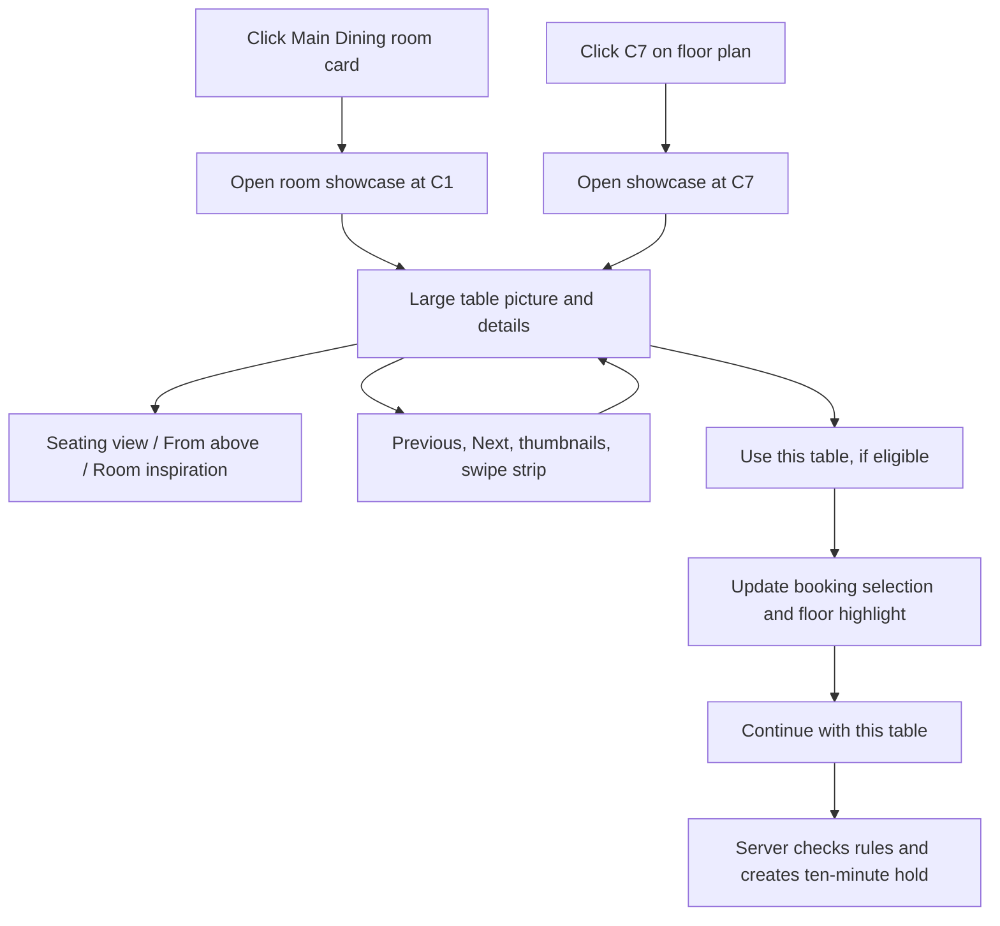

# Table showcase: research and implementation proposal

Research date: 2026-10-06. Owner: Marvin. This extends the completed P0–P7 laptop delivery. It is a design proposal and an interactive research concept; the live app has not yet received this feature.

## 1. Request and inspected screen

Marvin wants a picture for every table, with sliding navigation, and clarified that **clicking a table opens its showcase**. The supplied screenshot shows the four cards under “Find your corner”: VIP Rooms, Main Dining, Group Tables and Terrace & Bar. These are room categories, rather than individual table records.

Recommended entry points:

1. Click a room card in that section → open the room's table showcase.
2. Click a physical table in the booking floor plan → open the same showcase already positioned at that table.
3. In the showcase, browse other tables using labelled thumbnails, Previous/Next buttons or touch scrolling.
4. Explicitly choose a table only when it is eligible for the current date/time/party. Looking at an image never starts a hold.

The interactive concept is [table-showcase/concept.html](table-showcase/concept.html). It opens directly as a local HTML file and uses downloaded images and original SVG drawings. It represents all 25 current physical tables with their actual catalog codes, shapes and capacity ranges. It deliberately makes no reservation or availability claim.

During this session it is also available at **http://localhost:8092/table-showcase/concept.html**. To restart the local research preview from the repository folder:

```bash
python3 -m http.server 8092 --bind 127.0.0.1 --directory research
```

## 2. Recommended design

**A table-detail dialog with a large visual, three named image views and a room-filtered table strip.** On a laptop, visual and details sit side by side. On mobile, they stack in one scrollable dialog. Closing returns focus to the card or table that opened it.

The desired experience:



A dialog fits Marvin's click-to-open request and leaves the current booking screen in place. This is a project-specific design judgment, not a measured conversion result. It requires careful keyboard focus and a visible Close button. W3C's dialog guidance covers initial focus, Escape, modal navigation and returning focus to the invoking control. [W3C modal dialog pattern](https://www.w3.org/WAI/ARIA/apg/patterns/dialog-modal/).

### What the guest sees

| Element | Content and purpose |
|---|---|
| Header | Room name, table code and familiar table label; example: “Main Dining · C1 · Table 12” |
| Large visual | A consistent perspective picture of the selected physical table |
| Three views | Seating view, From above, Room inspiration; named controls instead of unexplained dots |
| Facts | Capacity range, table shape, room, verified minimum spend/notice and joined-table status when applicable |
| Availability | Selected date/time/party plus Eligible, Unavailable, or Choose a date; never infer availability from a photograph |
| Table strip | Thumbnails labelled C1, C2, etc., visible selected outline and “Table 3 of 12” |
| Action | “Use this table” for an eligible option, or a clear route back to date/time search |
| Close | Visible button and Escape; browsing leaves an existing held/confirmed booking unchanged |

OpenTable's dining-area feature lets guests choose an area and seating type. That supports showing room context early, but it is not evidence that OpenTable guarantees selection of a specific numbered table. Our exact-table interaction is based on this application's existing physical inventory. [OpenTable dining areas](https://www.opentable.com/blog/dining-areas/).

### Keep two types of sliding distinct

The table strip switches between tables; the named view controls switch pictures **of the current table**. Show both labels clearly. A swipe gesture must not silently change the committed booking selection. Avoid two automatically rotating carousels. The large image stays still until the guest acts.

Baymard's product-gallery research found that thumbnails help people discover additional pictures, and that hidden thumbnails need clear signposting. Applying that to restaurant previews is an inference: the original research concerns product evaluation, not restaurant bookings. Use visible thumbnails, arrows, a count and a partly visible next thumbnail. [Thumbnail research](https://baymard.com/research-articles/always-use-thumbnails-additional-images), [hidden-thumbnail research](https://baymard.com/research-articles/truncating-product-gallery-thumbnails).

All 25 tables remain discoverable through a labelled “View all tables” grid, with four room filters. Guests should not have to advance through 24 slides to reach the final table. NN/G cautions that people may overlook carousel content and recommends discoverable navigation. Its suggested short sequence applies to promotional carousels; it should not be treated as a ban on this room-filtered inventory gallery. [NN/G carousel usability](https://www.nngroup.com/articles/designing-effective-carousels/).

## 3. Best visual format for this app

| Option | Strength | Limitation | Recommendation |
|---|---|---|---|
| Original perspective SVG illustration | Sharp at every screen size, small, local, easily matches exact table shape/capacity | Stylized; does not show a real room photograph | Best first delivery; the concept demonstrates this |
| Static images rendered from 3D models | Consistent camera/materials, attractive depth, simple runtime image display | Needs composition/rendering work; generic pack models need styling | Good visual upgrade using Kenney CC0 models |
| Actual venue photographs | Faithful when each physical table is photographed and labelled | No actual Lumina venue or table photos exist in this fictional project | Use later if an actual venue replaces the demo |
| Stock restaurant photographs | Warm atmosphere and useful art references | Different venues; cannot truthfully represent every exact Lumina table | Use as clearly labelled room inspiration only |
| Interactive 3D/360 viewer | Rotatable environment | Asset, performance, keyboard and mobile work; more dependencies | A later enhancement after the basic gallery is verified |

**Proposed visual direction:** warm walnut tables, charcoal surroundings, muted amber highlights, consistent chair styling, a clear table silhouette and soft perspective shadows. Keep the current Lumina typography and dark palette. Every table gets an identity through its code, shape, seat count and location inset. Similar tables can legitimately share a visual base, but each preview must identify the exact catalog entry.

The concept's drawings are original vector illustrations made from the verified shape/capacity data. They are not baked 3D renders. Chair placements and furniture dimensions are illustrative, not measurements or access-clearance guarantees. Verified metadata stays readable as text outside the image. Do not invent “window view,” “quietest,” “wheelchair accessible” or precise dimensions from stock photos or floor coordinates.

### Suggested image set per table

- Main image: consistent perspective seating illustration or baked 3D render.
- Second image: top view and highlighted floor-plan position.
- Optional third image: labelled room inspiration; later replace it with an actual room/table photo if available.
- Joined option: one composite view showing both physical members, labelled G1 + G2, with the group's actual capacity. It is not a new physical table or permission to combine arbitrary members.

## 4. Curated pictures and 3D assets

The following files were downloaded and visually inspected. Their provenance and SHA-256 hashes are in [credits.json](table-showcase/assets/credits.json). They are research references, stored outside `public/`, and are not yet served by the live app.

| Preview | Source and author | Intended use | Fit assessment |
|---|---|---|---|
| [Warm wooden table](table-showcase/assets/main-dining-reference.jpg) | [Michel Stockman / Unsplash](https://unsplash.com/photos/shallow-focus-photography-of-rectangular-brown-wooden-table-with-chairs-set-QrOoMocamu0) | Main Dining and long-table materials/lighting | Strong amber/wood match; not a faithful image of C1 or G1 |
| [Round dining table](table-showcase/assets/round-table-reference.jpg) | [Mustafa Fatemi / Unsplash](https://unsplash.com/photos/a-dining-room-with-a-table-chairs-and-pictures-on-the-wall-ZZwUrJlmRTU) | Round-table setting and warm atmosphere | Clear table and chair view; not evidence of a private VIP room |
| [Terrace seating](table-showcase/assets/terrace-reference.jpg) | [pipop kunachon / Pexels](https://www.pexels.com/photo/table-and-chairs-on-restaurant-terrace-18675120/) | Outdoor seating reference | Clear seating, but bright colors and portrait crop fit Lumina less well; an alternate reference rather than the final art direction |
| [CC0 furniture overview](table-showcase/assets/kenney-furniture-preview.png) | [Kenney Furniture Kit](https://kenney.nl/assets/furniture-kit) | Source models for consistent static 3D renders | Contains tables/chairs; useful geometry, but default colors/style need adaptation |

The two Unsplash pages identify the selected photographs as free under the Unsplash License. That license allows downloading and use, including commercial use, with restrictions such as selling unmodified images and building a competing image service. Attribution is appreciated. [Unsplash License](https://unsplash.com/license).

The Pexels page identifies the terrace picture as free to use. Its license permits website use and modification, with restrictions on resale/redistribution as stock and implying endorsement. Keep its photographer credit even though attribution is optional. [Pexels License](https://www.pexels.com/license/).

Kenney's official Furniture Kit page identifies its 3D pack as CC0. The downloaded archive's `License.txt` independently states CC0 and covers personal, educational and commercial use; a copy is [saved here](table-showcase/assets/kenney-license.txt). The inspected archive contains `table.obj`, `tableRound.obj`, `tableCloth.obj` and other table/chair assets. The overview image was extracted from its `Preview.png`. The full model archive remains in the temporary tooling folder; no 3D runtime was installed. [Official Furniture Kit](https://kenney.nl/assets/furniture-kit).

For live implementation, save approved pictures under local `/assets/images/tables/` or `/assets/images/rooms/`, keep a source/credit record and a discreet image-credits link. Downloaded research references do not automatically become exact-table photos. No stock image subscription, API key, purchase or paid rendering service is needed for this proposal.

## 5. Interaction and accessibility requirements

The following are acceptance requirements for our implementation, rather than results already achieved by the live application:

- Room cards are real buttons/links with a visible “Explore tables” affordance; hover is optional decoration.
- Table preview buttons have names identifying the table and room. Preserve the floor plan's radio/list fallback.
- Opening focuses the dialog heading or a sensible first control. Escape and Close return focus to the opener, or the corresponding rerendered control.
- Use native dialog behavior and test keyboard navigation; do not create a hover-only popup.
- Previous/Next and thumbnails work with keyboard and pointer. Swiping is an additional input method, never the only one. W3C requires a simple pointer alternative for dragging interactions. [Dragging guidance](https://www.w3.org/WAI/WCAG22/Understanding/dragging-movements.html).
- No autoplay. Respect reduced-motion preferences. Announce a user-requested table change politely without repeatedly reading the entire dialog. W3C's carousel guidance covers named slides, controls and rotation behavior. [Carousel pattern](https://www.w3.org/WAI/ARIA/apg/patterns/carousel/).
- Aim for comfortable 44px controls; verify the actual WCAG minimum/spacing requirements. Use text plus an icon or outline for selection/availability, with readable contrast. [Target-size guidance](https://www.w3.org/WAI/WCAG22/Understanding/target-size-minimum.html).
- At 320px, the dialog and document fit without horizontal page scrolling. The thumbnail strip can scroll inside its own region. Keep Close visible and the selected-table summary easy to find.
- An image error falls back to the original table illustration and preserves text, controls and availability. A slow image must not disable booking.
- Ineligible tables can be explored but cannot be selected for a booking. Explain closure, party fit, notice or absence from the current options only when known; do not claim “reserved” when the actual reason may be something else.

## 6. Implementation fit and booking safety

Existing code already supplies most of the necessary data:

| Existing component | Proposed integration |
|---|---|
| `CatalogService::get()` | Public table IDs, room IDs, codes, labels, shape, capacity and plan coordinates; use these rather than hardcoded duplicate capacities |
| `guest.js` room cards | Add accessible click-to-open entry for the room's tables |
| `guest.js::renderPicker()` | Open the same viewer for the clicked eligible table/option; explicitly apply selection on “Use this table” |
| `choose(option)` | Keep it as the one selection handler for radio, map and gallery; synchronize every joined member |
| Hold/modify endpoints | Continue sending existing `kind` and numeric `id`; an image filename never authorizes inventory |
| Existing CSS/JS assets | A small local viewer module and CSS; no carousel framework is needed |

Use one `previewedTable` and a separate `selectedOption`. Browsing must not mutate a saved reservation, release a hold or restart its expiry timer. Before explicit selection, resolve the table against the current slot's server-returned options. After a date/party/room/time change, refresh eligibility. Confirmation continues through the existing transaction and rules.

For the first version, deterministic code-to-asset mapping in a local manifest avoids a schema migration. Metadata still comes from MySQL. If staff later need to edit/upload images, design that separately with file validation, roles and an additive database migration; it is outside this research request.

Suggested implementation files: `public/assets/js/table-showcase.js`, `public/assets/css/table-showcase.css`, `public/assets/images/…`, small edits to `src/View/guest.php` and `public/assets/js/guest.js`, plus image credits and focused browser scenarios. No changes to booking policy, staff authentication, kitchen logic or existing records are needed.

CSS scroll snap supports touch-scrolled thumbnail/card strips without a slider dependency. Use it as presentation; manage labels, selection and buttons in JavaScript. [MDN CSS scroll snap](https://developer.mozilla.org/en-US/docs/Web/CSS/Guides/Scroll_snap).

Performance targets are project recommendations to verify, not measured results: use modest thumbnail files and approximately 80–180KB main images when visually acceptable; do not eagerly download three large images for all 25 tables. Give images dimensions, load the initially visible picture promptly and defer offscreen alternatives. Browser lazy loading may prefetch carousel neighbors, so measure requests instead of assuming exactly one image downloads. [Google image-loading guidance](https://web.dev/articles/browser-level-image-lazy-loading).

## 7. Stages and completion checks

| Stage | Status | Deliverable | Completion check |
|---|---|---|---|
| S0 — Research | Done | This recommendation, inspected screenshots, primary sources, local licensed references and clickable concept | Sources/license records and current inventory checked; concept verified separately |
| S1 — Table visuals | Planned | Final coherent artwork for every physical table and a joined composite; local manifest and credits | 25 IDs covered, shapes/capacities correct, visible illustration labels, no invented features, all image fallbacks work offline |
| S2 — Click-to-open integration | Planned | Clickable room cards and floor tables open the viewer; thumbnails/arrows/swipe browse; explicit eligible selection | Opened table is correct, map/list/viewer agree, browsing starts no hold, old booking/hold stays intact |
| S3 — Verification | Planned | Mobile, keyboard, image-failure, offline and booking regression checks | 320px reflow; accessible modal; joined selection; eligibility refresh; guest regression and readiness checks pass; main data retained |

P0–P7 remain Done. A research concept is not a completed live booking feature. Future sessions should resume at S1 using this document and the latest `PLAN.md` checkpoint.

## 8. Evidence limits

The concept demonstrates click-to-open, per-table views, thumbnails and table navigation using a snapshot of public inventory. It has no server availability, hold or reservation connection. References from other venues and stylized chair layouts cannot establish the fictional venue's physical appearance, dimensions, acoustics or accessibility. UX findings support the recommendation; this particular workflow has not yet been evaluated with real diners. During live integration, verify the existing booking behavior rather than relying on the concept as proof.

Concept verification passed **29 checks**, including opening each of the 25 exact physical table previews, all four room cards, 320/390/768/1440px reflow, zero automated A/AA violations in tested states, named views, loaded local photos, Escape/focus restoration, and no external requests or JavaScript errors. Source credits/hashes, the inventory wrapper and all local report links were also checked. This evidence applies to the research concept, not the unimplemented live integration.

Reproduce using the temporary browser tools documented in `docs/verification.md`:

```bash
PLAYWRIGHT_MODULE=/tmp/lumina-browser/node_modules/playwright/index.mjs \
AXE_MODULE=/tmp/lumina-browser/node_modules/@axe-core/playwright/dist/index.mjs \
LD_LIBRARY_PATH=/tmp/lumina-browser/libs/usr/lib/x86_64-linux-gnu \
node research/table-showcase/verify.mjs
```

Screenshots are written outside the repository to `/tmp/table-showcase-research` by default. The preview server exposes only the research folder on localhost; the main app remains at port 8080.

## 9. Table inventory mapping

The current public catalog and declared G1–G2 group are captured in [inventory.json](table-showcase/inventory.json). The concept reads the matching `inventory.js` wrapper so it also works when opened directly from disk. Capacities and shapes are summarized below.

| Code | Existing label | Room | Shape | Guests |
|---|---|---|---|---|
| V1 | Suite 1 | Suites | round | 2–6 |
| V2 | Suite 2 | Suites | round | 4–10 |
| V3 | Suite 3 | Suites | round | 2–4 |
| V4 | Suite 4 | Suites | round | 4–8 |
| C1 | 12 | Main Dining | square | 1–2 |
| C2 | 14 | Main Dining | square | 1–2 |
| C3 | 16 | Main Dining | square | 2–4 |
| C4 | 18 | Main Dining | square | 2–4 |
| C5 | 20 | Main Dining | square | 1–2 |
| C6 | 22 | Main Dining | square | 2–4 |
| C7 | 24 | Main Dining | square | 2–4 |
| C8 | 26 | Main Dining | square | 1–2 |
| C9 | 28 | Main Dining | square | 2–4 |
| C10 | 30 | Main Dining | square | 2–4 |
| C11 | 32 | Main Dining | rect | 2–4 |
| C12 | 34 | Main Dining | rect | 2–4 |
| G1 | Long A | The Long Room | rect | 5–10 |
| G2 | Long B | The Long Room | rect | 5–10 |
| G3 | Oak | The Long Room | rect | 6–16 |
| T1 | B1 | Terrace | square | 1–2 |
| T2 | B2 | Terrace | square | 1–2 |
| T3 | B3 | Terrace | square | 2–4 |
| T4 | B4 | Terrace | square | 2–4 |
| T5 | B5 | Terrace | rect | 2–6 |
| T6 | B6 | Terrace | square | 1–2 |

Declared joined option: **G1 + G2, 11–16 guests**. This must have a combined preview while retaining both physical table identities and the existing manager-approval rule for 13–16 guests.
