# 15 — Bella Vista requirements and restaurant-reference research

Research date: 2026-10-17. Status: **research and recommendations only**. No Bella Vista feature, migration, billing behavior or payment integration was implemented. PLAN.md owns requirements, phase status and the next action. This research snapshot predates the name-only B1 delivery and later B0 choices. PLAN.md now records the approved schedule/VIP/onsite route, selected cancellation and operational contracts, and actual read-only legacy-to-nine-unit mapping. Its decisions supersede open or alternative recommendations here; B2 inventory/schedule and populated restore are now verified only in isolation. B3 fee/credit/onsite-recording delivery and populated restore are also verified in isolation (2026-10-18); main activation and guest cart/cancellation/grace/reports remain pending. Consult PLAN.md for current status.

**Reading terms:** a quote is the price/rule summary before saving; a ledger is a history of receipts and credits; idempotency means a retry returns the same saved operation; migration means changing the database structure/catalog; reconciliation means checking related records agree; a snapshot preserves values as accepted at that time.

## 1. What this research establishes

The three assignment DOCX files remain the authority for Bella Vista's name, profile, inventory, prices and policies. Public restaurant references help us choose presentation patterns; platform/technical documentation helps us implement and test them. Neither can fill an ambiguous assignment rule without a recorded B0 decision.

Main conclusions:

- An exact real-world match for the assignment's Bella Vista Dining was **not verified**. Similar names exist, including a Philippine resort/restaurant, but none of the reviewed pages establishes the supplied 2021 estate-to-independent-dining history. Treat the profile as an assignment-provided client narrative unless the instructor identifies a real client.
- Farmer's Table is the strongest concept reference among the reviewed candidates. Sonya's Garden supports the garden/story direction; Balay Dako supports Filipino family-dining content; Qsina supports clear menu/reservation entry points. These are separate businesses.
- Extend the existing PHP/MySQL application. Separate booking, scheduled food, preparation, billing and settlement states; keep monetary values server-owned and retry-safe.
- Add specific migration/restore, quote review, consumable-credit, preorder handoff, late-arrival, report-reconciliation and accessible-checkout checks to B0–B8. Those checks are **planned acceptance**, not passing test evidence.

## 2. Is Bella Vista Dining an existing restaurant?

### Search scope and confidence

Searched exact name, name plus Philippines, name plus farm-to-table, name plus 2021/estate, and distinctive wording from the supplied history. Reviewed the following first-party pages. This is a public-web identity check, not a business-registry or trademark clearance; an absent result does not establish nonexistence.

| Name/location found | First-party evidence | Identity conclusion |
|---|---|---|
| Bella Vista Resort & Sharkeys Restaurant, La Union | Its [official site](https://bellavistaresortlaunion.com/) identifies the resort/restaurant in its page title and presents lodging, cottages and event spaces. | A Philippine name similarity; no reviewed evidence ties it to the assignment's exact identity, history or nine-unit restaurant rules. Do not import its room-booking model. |
| Bella Vista Country Club, Marlboro, New Jersey | The [official dining page](https://bellavistacountryclub.com/dining-reservation/) supplies its New Jersey address and country-club dining context. | Its page title contains Bella Vista Dining, but this is not evidence of a Philippine client. |
| Bella Vista Legian Coffee Shop & Juice Bar, Bali | The [official site](https://www.bellavistabali.com/) describes Australian/European/Balinese food and a Legian location. | A separate business with a different cuisine/location. |
| Bella Vista Estate, Santa Barbara | The [official estate site](https://bellavistaestatesb.com/) describes a California event property. Its footer displays 2021. | A copyright year does not prove the assignment's restaurant was established there in 2021. Do not infer that link. |

**B0 recommendation:** retain the required Bella Vista Dining name and supplied 2021 narrative, explicitly described as assignment-supplied in the proposal/defense. Do not present the research as proof of a real restaurant or business affiliation. Ask for an official address/site only if the instructor says the client is real. No owner name, branch, customer rating, award, real-world contact detail or existing logo is verified for this client.

## 3. Comparable restaurants: what we can adapt

| Restaurant / reviewed official source | Verified fit | Pattern suitable for our app | Difference that must not become our policy |
|---|---|---|---|
| [Farmer's Table, Raintree Hospitality](https://www.raintreehospitality.net/farmerstable) | The operator describes local sourcing and a nature-focused farm-to-table concept in Tagaytay. | Main inspiration: a strong original food photograph, concise sourcing/concept copy and a clearly reachable menu. Translate this into Bella Vista's assigned Filipino/continental identity. | Public pages do not establish our required fees, table counts, grace period or cart behavior. The [official linked menu](https://www.raintreehospitality.net/farmerstablemenu) is a reference, not our catalog or price list. |
| [Sonya's Garden restaurant](https://sonyasgarden.com/restaurant/) | Garden setting, plot-to-plate narrative, visible menu and Reserve Your Seat links. | Garden imagery, readable company story and easy menu-to-reservation navigation. | The page includes buffet offerings and its own schedule; Bella Vista requires an item cart and its assigned operating rules. |
| [Balay Dako, Antonio's Group](https://www.antoniosrestaurant.ph/balay-dako) | Filipino food/family story and gallery; regular dining explicitly does not take table reservations. | Separate About/History blocks and family-oriented food presentation. | Its first-come-first-served regular-dining policy conflicts with our mandatory reservation system. Event-room capacities are unrelated to our VIP rooms. |
| [Qsina, The Bellevue Manila](https://www.thebellevuemanila.com/dining/qsina) | Official page describes international and Filipino dining, with a menu and Reserve a Table link. | Keep Menu and Reserve entry points easy to identify, with operating information nearby. | Hotel meal schedules/buffets, menus and linked booking provider are not Bella Vista requirements. |

**Recommendation, not a selected design:** use Farmer's Table for concept/food emphasis, Sonya's for garden atmosphere, and Balay Dako for company-story structure. Build an original Bella Vista identity. The existing warm Lumina palette/fonts can be assessed for reuse; this research does not approve a new palette, logo or full visual redesign.

**Actual browser inspection:** visited the first three restaurant pages at 1366×768 with reduced motion, GET/HEAD requests only, and no form submission. All returned HTTP 200 and produced top/below-the-fold captures. Reviewed the Farmer's Table food-led opening, Sonya's prominent reservation CTA/garden hero and Balay Dako's story section. No page-width overflow was detected at this one viewport. Blocked non-read requests (27/6/4 respectively) can affect analytics/widgets; this is not a full functional or accessibility audit. Qsina was read as page content only. Temporary captures/observations are under `/tmp/bella-vista-research`; they are not application assets or permanent verification artifacts.

Use original or properly licensed media in the product. Do not transfer these businesses' logos, photographs, stories, reviews, addresses, menus or named staff into Bella Vista as its own. No restaurant assets were added to the application.

## 4. Source findings and project implications

Each implication below is our application-specific inference, not a claim that the provider implements Bella Vista's rules.

| Primary source inspected | Bounded finding | Implication for this project |
|---|---|---|
| [OpenTable: reservation deposits](https://www.opentable.com/blog/deposits/) | Describes deposits as advance meal payment, applied to the check or refunded under the venue's arrangement. | Explain the assigned consumable fee separately from food charges; do not count an advance and the credited bill twice. This does not determine Bella Vista refund terms. |
| [Toast: scheduled orders](https://support.toasttab.com/en/article/Scheduling-Future-Orders) | Separates future checks from kitchen firing, with configured preparation timing and an explicit early-fire action. | Store pre-orders without treating them as already cooking. Recommend staff release after arrival for the first batch, subject to B0. No Toast integration is proposed. |
| [Square: invoice deposits](https://squareup.com/help/us/en/article/6581-request-deposits-with-square-invoices) | Its invoice workflow distinguishes partial receipts from fully paid invoice reporting. | Collection time and food-sale attribution can differ. Name each report's date basis; do not copy Square invoice behavior as a universal accounting rule. |
| [Square: sales reports](https://squareup.com/help/us/en/article/5381-in-app-summaries-and-reports) | Documents distinct sales, collection, refund and fee measures. | Define daily food sales independently of booking counts and money collected. Do not label all existing order totals as paid sales. |
| [Stripe: currency amounts](https://docs.stripe.com/currencies) | API amounts use currency minor units. | Continue integer centavos for PHP amounts, validated limits and formatted peso displays. This is a data-model reference, not a payment-provider choice or merchant-availability claim. |
| [Stripe: idempotent requests](https://docs.stripe.com/api/idempotent_requests) | A request key supports safe retry; changed parameters under the same key are rejected. | Bind confirmation/settlement/handoff retries to the original payload; use a new operation for a changed cart. Do not copy provider-specific key-retention rules without design. |
| [OWASP: business logic security](https://cheatsheetseries.owasp.org/cheatsheets/Business_Logic_Security_Cheat_Sheet.html) | Recommends trusted server derivation and explicit workflow/concurrency enforcement. | Send item IDs/quantities, recalculate prices/eligibility, and check allowed transitions at each operation. UI-disabled controls are insufficient. |
| [MySQL 8.4: locking reads](https://dev.mysql.com/doc/refman/8.4/en/innodb-locking-reads.html) | Plain reads do not protect a later dependent write; locking reads operate within transactions. | Reuse ordered inventory locks and add a consistent reservation/bill lock order. Recheck grace, ownership and credit balance after locks. |
| [MySQL: implicit commits](https://dev.mysql.com/doc/refman/8.4/en/implicit-commit.html), [atomic DDL](https://dev.mysql.com/doc/refman/8.4/en/atomic-ddl.html) | Schema changes can implicitly commit; atomic DDL does not make a multi-statement migration transactionally reversible. | Separate schema evolution from catalog conversion. Do not claim a surrounding ROLLBACK protects every migration step. |
| [MySQL: mysqldump](https://dev.mysql.com/doc/refman/8.4/en/mysqldump.html) | A single-transaction dump gives an InnoDB snapshot, with concurrent DDL caveats. | Rehearse a compatible private backup/restore with schema writes stopped; validate restored history before main conversion. |
| [PHP: date/time arithmetic](https://www.php.net/manual/en/datetime.examples-arithmetic.php) | Demonstrates explicit date/time interval arithmetic and timezone effects. | Reuse server BookingClock/Asia/Manila; distinguish elapsed 24-hour notice from local-calendar same-day forfeiture. Browser time must not decide either. |
| [W3C: form validation](https://www.w3.org/WAI/tutorials/forms/validation/), [notifications](https://www.w3.org/WAI/tutorials/forms/notifications/) | Describes server validation, field-associated errors and actionable feedback. | Cart/booking errors should identify the item/field and correction, preserve recoverable input, and expose an error summary. |
| [W3C: error prevention](https://www.w3.org/WAI/WCAG22/Understanding/error-prevention-legal-financial-data.html) | Important submissions need reversibility, checking or a review/confirmation mechanism. | Show a final booking/bill/policy review with a way to correct details before committing. A checkbox by itself does not demonstrate this criterion. |
| [W3C: reflow](https://www.w3.org/WAI/WCAG22/Understanding/reflow.html), [focus visibility](https://www.w3.org/WAI/WCAG22/Understanding/focus-not-obscured-minimum.html) | Addresses narrow/zoomed layouts and keyboard focus not fully hidden by author content. | Verify cart/summary at 320 CSS px and zoom; contain table/map scrolling, and prevent sticky bars/dialogs from hiding focused controls. |
| [W3C: status messages](https://www.w3.org/WAI/WCAG22/Understanding/status-messages.html) | Success/progress messages can be exposed to assistive tools without moving focus. | Announce cart totals/save outcomes politely; passive polls must not repeatedly steal focus or announce every unchanged row. |
| [W3C: Pause, Stop, Hide](https://www.w3.org/WAI/WCAG22/Understanding/pause-stop-hide.html) | Auto-started nonessential movement lasting over five seconds alongside content needs an applicable pause/stop/hide mechanism. | Revisit the continuous guest visuals in B8. Reduced-motion handling alone is not proof that all users have that control. Preserve Marvin's preference while reviewing options; no automatic motion change is authorized. |
| [OWASP: logging](https://cheatsheetseries.owasp.org/cheatsheets/Logging_Cheat_Sheet.html) | Identifies tokens, credentials and sensitive data that should not be logged directly. | Audit staff decisions, amounts and record identifiers without raw private links, passwords, card data or guest contact dumps. Use synthetic records for defense screenshots. |
| [IBM: DFD](https://www.ibm.com/think/topics/data-flow-diagram) | Distinguishes external entities, processes, stores and flows; explains context versus decomposed levels. | A PHP request-flow diagram is not the requested calculation-focused DFD. Recommend a Level 1 submission with explicit inputs/outputs and a notation legend. |
| [GAO: cost-estimating guide](https://www.gao.gov/products/gao-20-195g), [PMI: work breakdown structure](https://www.pmi.org/blog/work-breakdown-structure) | Relate estimates to scope/work packages and stated assumptions; scope decomposition differs from a dated schedule. | Build proposal costs/timeline from agreed deliverables, team availability and dependencies. Mark estimates and actuals separately; no invented supplier quotes or presentation dates. |

Access limits: two OpenTable help articles returned a loading/CSS shell on direct open. Their search-index excerpts were not used to establish additional implementation rules; the accessible deposit article above is the cited deposit reference. Public vendor documentation was read; authenticated OpenTable/Toast/Square dashboards and payment APIs were not operated. The dated 2025 Farmer's Table PDF was found, but its image-only content/prices are not used as current menu evidence. The current operator menu link is preferred. No real reservation, payment, external account or message was created.

## 5. Current source: reuse versus additions

Inspected the current Desktop checkout rather than treating the prototype as the application:

| Source | Existing foundation | Addition/review needed |
|---|---|---|
| `src/Service/BookingClock.php`, `BookingPolicy.php`, `AvailabilitySnapshot.php` | Database clock, party/time validation and availability intervals | New category limits/120-minute duration, slot/buffer decision, deadline-aware release and matching guest/staff availability. |
| `src/Service/BookingTransaction.php`, `BookingService.php` | Ordered day/table locks, retries and consumed-hold recovery | Atomic confirmation including accepted policy, fee quote and scheduled cart. Existing confirmation saves a reservation without a guest pre-order. |
| `src/Service/ManagementService.php` | Private access, versions and shared edit/cancel cutoff | 24-hour cutoff plus explicit edits/cancellation/credit/preorder behavior. Do not split consistency across separate requests. |
| `src/Service/OrderService.php`, `database/init/07_menu_kitchen.sql` | Staff seated-order guard, trusted menu prices, line snapshots, tickets and unpaid service closure | Scheduled preorder ownership/transfer and a separate settlement record. Do not expose staff mutation endpoints to anonymous guests or turn `closed` into evidence of payment. |
| `database/init/01_schema.sql` | Active inventory flags, deposit columns and order totals | Deposit columns alone do not record receipts, allocations, refunds or forfeiture history. A bill/settlement design is needed before migration. |
| `src/Controller/StaffController.php` | Selected-day reservation/covers aggregates and floor data | Food-sales reporting, cleanup labels, new policies and explicit report date basis. Existing daily counters do not aggregate food sales. |
| `config/routes.php` | Separate guest/private-management/staff/service routes | No current guest preorder or settlement/report route is established; new contracts must use the proper ownership/role checks. |
| `src/View/guest.php`, guest/staff/service scripts and floor/showcase assets | Delivered booking UI, licensed visuals and service screens | Bella Vista content/catalog/quote review and scoped operational readability; do not repeat already delivered guest polish. |

No main database query/migration or application test suite was required for this research task. These findings describe inspected source and historical foundations, not fresh proof of feature correctness.

## 6. Recommended B0 decisions, with tradeoffs

All recommendations in this section are **unapproved product choices**. Record Marvin/instructor decisions before implementation. External sources do not settle the unspecified assignment details.

### Schedule and cleanup

Two-hour dining duration is required. Fixed starts at 10:00/12:00/14:00/16:00/18:00/20:00 are a clear demonstration option, not a stated rule. With the existing 15-minute reset buffer, a 10:00–12:00 party blocks until 12:15, so the same unit is unavailable at 12:00. A blanket `blocks_until <= 22:00` check also rejects the otherwise valid 20:00–22:00 dining block.

Resolve this conflict explicitly: keep truthful unavailable slots while cleanup lasts, adjust start spacing, or agree a different reset model. Do not hide cleanup inside a promised 120-minute dining session. Recommend evaluating a distinction between dining-close and cleanup-close: dining must end by 22:00, while reset may finish afterward if approved. A seated table remains occupied until host completion; reaching the planned end time must not erase a real party.

### Standard minimum and booking cart

Recommend allowing optional guest pre-orders, with a visible ₱1,000 target for Standard and a staff order-review step at arrival to reach it before seating. This follows the supplied “upon seating” wording more closely than forcing every booking to prepay food. It requires the operational flow to review/add a scheduled order before the existing seated-only order flow.

An alternative is requiring Standard's cart to reach ₱1,000 before confirmation; that is simpler but adds a restriction the assignment does not explicitly state. Neither option is selected. Qualifying food value, later voids and split rounds must use the same reservation-level minimum check; a rejected cart is not a minimum-shortfall fee.

### Fees, balances and settlement

Propose a reservation-level bill that owns all food rounds and fee-credit allocations. Keep assessed fee, received advance, consumed credit, refunded amount and forfeited amount separately auditable. A scheduled reservation with ₱500 due has zero paid credit until a receipt is recorded. Recommend a labeled onsite/demo settlement path first; it needs no payment-provider account. A recorded card method must mean an external terminal receipt, not processing or storing a card in this app.

Proposed invariants: amounts are nonnegative integer centavos within supported bounds; applied credit plus refunds plus forfeiture cannot exceed the actually received advance; credit allocations across all rounds cannot exceed the remaining credit. Refund/reversal entries retain links to their originals. Refuse new credit use after forfeiture. An advance credit changes the balance due, not the food subtotal.

VIP extra charges are `max(0, party_size - 15) × ₱300`. The base ₱2,500 is fully consumable; the brief does not say the ₱300 extras are consumable. Keep them separately quoted and leave that choice open. Unused credits, partial settlement, overpayment/change and price validity need explicit decisions too. No tax, service-charge or discount module is required by the supplied brief.

### Quote review and safe retries

Recommend a server-generated review containing service date/time/end, category/unit, guests, cart lines/quantities, food subtotal, minimum status, base reservation fee, VIP extra, amount due now/later and policy deadline/version. If an item becomes unavailable or its price changes before confirmation, show the revised quote for acceptance; do not silently accept the old browser total or charge a new amount unnoticed.

Within the existing transaction/lock discipline, confirm the held unit, authoritative price/fee snapshots, guest/booking, policy acceptance and scheduled pre-order together. An invalid cart or expired hold saves none of that booking bundle. Bind confirmation's retry identifier to the accepted payload. The existing consumed-hold shortcut returns the saved booking before examining any future cart additions; its extension must reject a changed payload under the same operation instead of silently ignoring it.

### Pre-order to kitchen handoff

Recommend a scheduled preorder linked to the booking, separate from a fired food round. Staff verify arrival/allergies and send the accepted order once through the existing kitchen workflow. A transfer identifier binds each scheduled line/batch to its resulting order/ticket. A future menu edit must not rewrite an accepted price/name snapshot; unavailable dishes at arrival need an explicit substitution/void decision.

A booking cancellation cancels un-fired scheduled food in the same business operation; it must not leave an orphan kitchen ticket. Once food is sent, current freeze/void permissions remain. A changed date/party can require repricing and updated minimum/extra-person checks. No new named order states or schema layout is approved by this research.

### Cancellation and arrival grace

Recommend `now <= starts_at - 24 hours` for timely self-service cancellation, using server time. Same-day is a local calendar comparison, not a synonym for less than 24 hours: cancelling Tuesday 23:00 for Wednesday 10:00 is late but not same-day. The brief states same-day Family/VIP forfeiture, but not the treatment of every late request, unused credit, earlier refund or no-show fee. Keep those open; do not infer automatic charging or no-show forfeiture.

For confirmed, not-arrived parties, evaluate release at `now >= starts_at + 15 minutes`; choose/document the exact equality rule. Reconcile under the same reservation/inventory locks as seating so only one outcome wins. Use a server reconciliation mechanism with catch-up after restart and deadline checks in booking/seating paths. Browser polling/countdowns cannot be the only enforcer. Never free a seated table because a tab closed, the guest was late earlier, or a planned timer expired.

### Safe catalog conversion

Recommend creating the nine target units while retiring old inventory from new searches, preserving old IDs/references and history. A public label change must not rewrite the meaning of an old reservation. Current `is_active` flags help but are not a complete migration strategy: inspect unresolved holds/bookings, active food rounds, duplicate room-type codes and legacy private links; decide how each remains operable.

Rehearse schema changes, catalog population/activation and rollback/restore separately on fresh and existing isolated data. Verify foreign keys, retained staff/configuration, old price snapshots and exact active nine-unit inventory. Do not rerun the Lumina seed to convert the venue. Restore proof must include a readable old booking/order, not only matching table counts. Main activation remains a separately authorized operation.

### Daily reports

Recommend two clearly labeled views: service-date reservation/food summary and settlement-date receipts/refunds. Pick the meaning of “total food sales” in B0; for a simple defense, use finalized non-void food bills attributed to the selected dining service date, with settlement status visible separately. This is a proposed reporting convention, not a legal/accounting rule.

For each chosen interval use one consistent Asia/Manila date basis and snapshot. Aggregate item lines, payment receipts and credit allocations separately before joining, or multiple lines/receipts can multiply totals. An applied deposit is a payment allocation, not another food-sale line. Distinguish cancellations, open orders, voids, fee forfeitures, refunds and settled balances. Keep all-date reservation search independent of selected-day totals. New bill/credit data must also update the existing admin permanent-delete eligibility; it must not orphan or erase financial history.

## 7. Concrete acceptance examples to add

These are proposed scenarios, **not tests run**. Use isolated synthetic records and controlled server time; verify persistence and history after each operation.

| Area / phases | Scenario | Expected result under the selected policy |
|---|---|---|
| Inventory, B2 | Count active target units; attempt Standard 1/2/4/5, Family 4/5/8/9, VIP 15/16/20/21. | Exactly four Standard, three Family, two VIP. Required category limits enforced client/server; VIP minimum stays a B0 decision. |
| Schedule, B2 | Monday search and direct confirmation; 09:59, 10:00, 20:00, 20:01/22:00 starts. | Closed/outside-window and invalid fixed/rolling starts refused; 20:00–22:00 handled according to the explicit dining/reset model. |
| Cleanup, B2/B6 | Back-to-back starts on one unit while the previous party is seated or cleaning. | No double assignment; visible cleanup and availability agree. Planned end alone does not complete a seated booking. |
| Atomicity, B3/B4 | Last item goes unavailable while a table is held; confirm a tampered price or incomplete policy acceptance. | No partial confirmed booking, fee receipt or orphan preorder; usable correction/review state. |
| Retry, B3/B4 | Replay saved confirmation/settlement; then reuse its key with a changed quantity/amount. | Same payload returns the existing outcome; changed payload is refused, without an extra booking/receipt/ticket. |
| Minimum, B3/B4 | Standard qualifying food totals ₱999, ₱1,000 and ₱1,001; then void below minimum. | Boundary enforced at the agreed point and across food rounds; no invented extra charge. |
| Consumable, B3 | Family: food ₱2,000, advance received ₱500, final receipt ₱1,500. | Food value ₱2,000; receipts ₱2,000 total; advance credit ₱500 applied once. |
| Unpaid advance, B3 | Family assessment ₱500, receipts ₱0. | Paid credit ₱0; no automatic receipt or hidden discount. |
| VIP, B3 | Compare 15,16,20 guests. | Base fees ₱2,500 each; extras ₱0/₱300/₱1,500 respectively. Final balance follows the documented consumable-extra decision. |
| Credit race, B3 | Two food rounds simultaneously try to allocate the same advance; refund races allocation. | Total allocations/refunds/forfeiture stay within received funds; one consistent outcome/history. |
| Preorder lifecycle, B4/B5 | Future booking → scheduled food → arrival → one kitchen send; retry after lost response. | No premature cooking; one agreed handoff; item/name/price snapshots preserved. Cancellation before firing prevents later send. |
| Cancellation, B5 | Before, exactly at and one second after the 24-hour deadline; cross-midnight late cancellation; edit-then-cancel attempt. | Correct server-time result; same-day handling not conflated with elapsed hours; no cutoff bypass. |
| Arrival release, B5 | Before/at/after 15 minutes; simultaneous host seating and expiry; restart after missed processing. | One lawful final state, released inventory once with history, catch-up after restart; seated guests stay protected. |
| Reporting, B6 | One bill, three lines, two receipts; advance yesterday, dining today, refund another day. | No join multiplication; food report and receipt/refund report follow their named date bases and reconcile to detail. |
| History/deletion, B2/B6 | Retired legacy unit's old private link/order; permanent-delete attempt on a booking with bill/receipt/credit history. | Historical records remain meaningful/authorized; no financial history is orphaned or silently erased. |
| Permissions, B3–B6 | Guest tries staff settlement; kitchen tries refund; one private link accesses another booking. | Server refuses unauthorized operations and returns no unrelated contact/payment details. |
| UI, B1/B4/B8 | Keyboard cart edit, final review correction, price-change error, zoom/320px and active dialog during refresh. | Labels/errors/statuses readable and associated, focus visible/stable, input retained where safe; page usable across sizes. |
| Motion, B8 | Continuous hero/chef/gallery alongside the form for more than five seconds. | Review a usable pause/stop/hide approach if claiming relevant WCAG conformance; do not mark this passed from reduced motion or automated scans alone. |
| Proposal/defense, B7/B8 | Trace a bill example from guest input through server computation, data stores, kitchen and daily report. | DFD, implemented flow, proposal figures and demonstrated evidence agree; synthetic/demo values clearly labeled. |

Report reconciliation examples must cover both a full food bill and its payment allocation. A daily receipt total can legitimately differ from that day's food sales when an advance was received on another date. Show the difference explicitly instead of forcing the numbers to match incorrectly.

## 8. DFD and proposal research

Recommend a **Level 1 logical DFD** because the assignment specifically wants booking input, calculations and confirmation. A context view can supplement it but is not necessary if one correct Level 1 diagram is delivered. The following is a research sketch, not an implemented-system diagram or final approved submission. Storage boxes use Mermaid's database shape for readability; the final formal DFD should name its notation and use that notation consistently.

```mermaid
flowchart LR
  Guest[Guest] -->|Date, party, category, item IDs and quantities| Quote(1.0 Validate and calculate quote)
  Catalog[(D1 Catalog, inventory and policy)] -->|Prices, capacities and rules| Quote
  Quote -->|Availability, item totals, fees and deadlines| Guest
  Guest -->|Accepted quote, contact and policy acceptance| Book(2.0 Confirm booking and scheduled food)
  Catalog -->|Current eligibility and policy version| Book
  Book -->|Reservation and held-unit outcome| Bookings[(D2 Holds and reservations)]
  Book -->|Scheduled items and accepted prices| Orders[(D3 Preorders and food rounds)]
  Book -->|Reference, summary and private management access| Guest
  Host[Host or server] -->|Arrival and authorized send request| Service(3.0 Manage food service)
  Bookings -->|Booking and assigned unit| Service
  Orders -->|Scheduled lines and current state| Service
  Service -->|Ticket and preparation instructions| Kitchen[Kitchen staff]
  Kitchen -->|Preparation and ready updates| Service
  Service -->|Handoff and service-state records| Orders
  Cashier[Authorized settlement staff] -->|Recorded onsite receipt or reversal| Bill(4.0 Settle bill and allocate advance)
  Orders -->|Non-void food values| Bill
  Ledger[(D4 Bills, receipts and credit allocations)] -->|Prior receipts and remaining credit| Bill
  Bill -->|Settlement and allocation records| Ledger
  Bill -->|Food bill and remaining balance| Guest
  Bookings -->|Service-date reservation records| Reports(5.0 Produce daily summaries)
  Orders -->|Food line values and states| Reports
  Ledger -->|Finalized bills, receipts and reversals| Reports
  Reports -->|Labeled daily totals and detail| Manager[Manager]
```

The final DFD must also document policy-acceptance/audit storage and guest modification/cancellation flows, either on this diagram or a balanced supporting detail. Direct external-actor-to-database arrows are inappropriate: application processes validate the data. Do not confuse a DFD with table relationships (ERD), a screen map or a sequence of code calls.

For the submission package, retain the assigned company profile/history while separating the developer team's own banner/profile. Suggested sections: cover/banner; team and roles; client/problem; original branding/hex palette with rationale; exact requirements/scope; calculation examples; DFD; technical approach/security/persistence; timeline; cost breakdown; acceptance/demo plan; sources and asset credits. These are organizational recommendations; actual team details remain unknown.

A cost worksheet should include work package, quantity/effort, assumed rate, one-time/recurring classification, subtotal, source/date or estimate basis, inclusions/exclusions and final total. Candidate rows: discovery/design, branding/content, booking/catalog conversion, billing/cart, reports, testing, documentation/defense, optional hosting/domain and maintenance. Mark existing resources and optional services honestly; no external service purchase is required by this research. Do not present blank costs as a completed quote. Set any contingency openly rather than hiding it in line rates.

Schedule dependencies: B0 establishes decisions; B1 branding and B7 drafting can advance alongside B2/B3 once their inputs are agreed. B4 depends on the inventory/fee contracts; B5 integrates policy with booking/cart; B6 needs those data/state contracts before final reports; B8 follows the integrated build and defense package. Effort estimates, team availability and the presentation deadline must be collected before calendar dates or a delivery promise are made. Researching commercial systems does not justify adding their subscriptions to the budget.

## 9. What changes in the roadmap

Add the research-based safeguards under existing B0–B8, not a duplicate competing plan. Prioritize rule consistency, fees/cart/persistence and required content over extra effects. Keep every phase Pending until implemented and freshly verified. B0 recommendations stay open until recorded approval; instructor clarification is needed only when the supplied business meaning cannot be settled with Marvin.

Scope additions: identity provenance; slot/reset boundary model; final quote/price reacceptance; reservation-level consumable-credit allocation; scheduled-to-fired food handoff; retry payload binding; post-restart grace reconciliation; schema/catalog backup-and-restore rehearsal; sales-versus-receipts report definitions and join checks; financial-history deletion protection; accessible review/status/focus; a calculation-focused DFD and cost/timeline basis.

No provider, library, real payment, main migration, new restaurant identity claim or publication is selected by this report. Public comparables are inspiration only. Existing local implementation and records remain unchanged.
